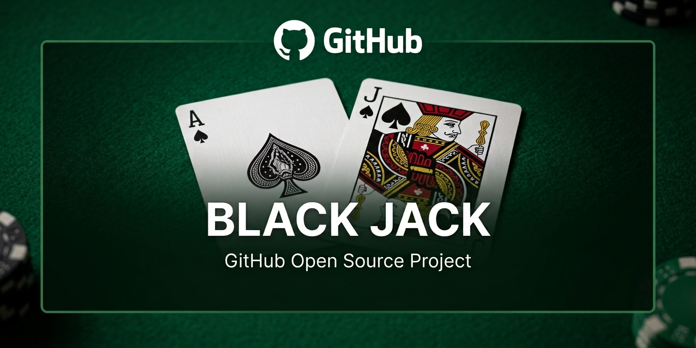

# Black-Jack-UNA

Group 3 | This repository is about a university programming 1 final project


<p align="center">
  
</p>


## Descripción
Este proyecto consiste en la implementación del juego Blackjack en lenguaje C++ para consola. El objetivo principal es recrear una partida de blackjack con reglas básicas, apuestas, turno del jugador, turno del crupier y lógica de pago según el resultado de cada ronda.

El juego está diseñado para ejecutarse en la terminal, y la lógica principal está organizada en clases para representar cartas, mazos, manos, jugadores, crupier, casa y la partida completa.

## Colaboradores / Integrantes
### Grupo 3:
- alonsx-02
- Gerson Andres Gómez García
- Brxnd49
- Kendal Obando
- wendervillegasgarcia-boop

  
## Objetivo del proyecto
Desarrollar una versión funcional del juego Blackjack con:
- manejo de jugadores,
- apuestas,
- reparto de cartas,
- decisión del jugador,
- lógica del crupier,
- validación de reglas del juego,
- y flujo completo de una partida.

# Cómo compilar y ejecutar?

## Requisitos
Para compilar y ejecutar el proyecto necesitas:

- Sistema operativo Windows
- Compilador de C++ con soporte para C++17
- MinGW o un compilador equivalente
- Terminal de comandos (PowerShell, CMD o Git Bash)

## Opción 1: Compilar con MinGW  
Desde la carpeta raíz del proyecto, abre una terminal y ejecuta:

```powershell
g++ -std=c++17 -I src .\src\*.cpp -o .\BlackJack-UNA.exe
```
Si el comando anterior falla por compatibilidad con el shell, puedes probar esta versión:

```powershell
g++ -std=c++17 -O2 .\src\*.cpp -o .\BlackJack-UNA.exe
```

## Ejecutar el programa:
```powershell
.\BlackJack-UNA.exe
```


## Estructura del repositorio
```text
Black-Jack-UNA/
├── src/
│   ├── Carta.cpp
│   ├── Carta.h
│   ├── Casa.cpp
│   ├── Casa.h
│   ├── Crupier.cpp
│   ├── Crupier.h
│   ├── Ficha.cpp
│   ├── Ficha.h
│   ├── Juego.cpp
│   ├── Juego.h
│   ├── Jugador.cpp
│   ├── Jugador.h
│   ├── main.cpp
│   ├── Mano.cpp
│   ├── Mano.h
│   ├── Mazo.cpp
│   ├── Mazo.h
│   ├── Participante.cpp
│   ├── Participante.h
├── docs/
├── README.md
├── .gitignore
└── .gitattributes
